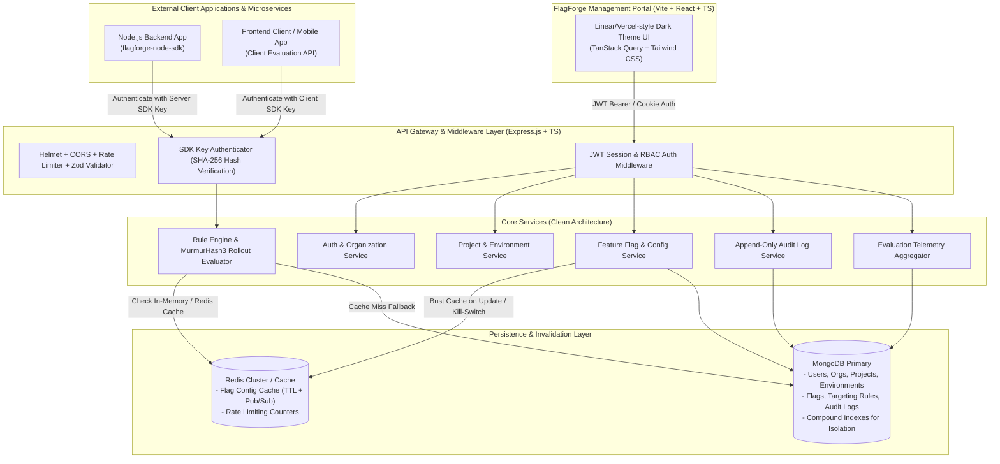

# FlagForge — Architecture & System Design Blueprint

## 1. Executive Summary & System Overview

**FlagForge** is a production-grade Feature Flag & Release Management Platform engineered for developer teams to decouple code deployment from feature release. It provides deterministic targeting, gradual canary percentage rollouts, multi-environment isolation, emergency kill-switches, audit trails, real-time evaluation telemetry, and an external Node.js SDK.

---

## 2. High-Level System Architecture



---

## 3. Database Schema Design (MongoDB / Mongoose)

### 3.1. User & Authentication (`users`)
```typescript
interface IUser {
  _id: ObjectId;
  email: string; // unique, lowercase, indexed
  passwordHash: string; // bcrypt with salt rounds 12
  name: string;
  isEmailVerified: boolean;
  verificationToken?: string;
  resetPasswordToken?: string;
  resetPasswordExpires?: Date;
  lastLoginAt?: Date;
  createdAt: Date;
  updatedAt: Date;
}
```

### 3.2. Organizations & Membership (`organizations`, `organization_members`)
```typescript
interface IOrganization {
  _id: ObjectId;
  name: string;
  slug: string; // unique slug e.g. "acme-corp"
  createdAt: Date;
  updatedAt: Date;
}

export type OrgRole = 'owner' | 'admin' | 'developer' | 'viewer';

interface IOrganizationMember {
  _id: ObjectId;
  organizationId: ObjectId; // indexed
  userId: ObjectId;         // indexed
  role: OrgRole;
  invitedBy?: ObjectId;
  joinedAt: Date;
}
// Compound unique index: { organizationId: 1, userId: 1 }
```

### 3.3. Projects & Environments (`projects`, `environments`)
```typescript
interface IProject {
  _id: ObjectId;
  organizationId: ObjectId; // indexed
  name: string;
  key: string;              // e.g. "mobile-checkout", unique per org
  description?: string;
  createdAt: Date;
  updatedAt: Date;
}
// Compound unique index: { organizationId: 1, key: 1 }

export type EnvironmentType = 'development' | 'staging' | 'production' | 'custom';

interface IEnvironment {
  _id: ObjectId;
  projectId: ObjectId;      // indexed
  name: string;             // "Development", "Staging", "Production"
  key: string;              // "development", "staging", "production"
  type: EnvironmentType;
  serverApiKeyHash: string; // SHA-256 hash of server SDK key (`ff_server_...`)
  serverApiKeyPrefix: string; // e.g. "ff_server_live_abcd..."
  clientApiKeyHash: string; // SHA-256 hash of client SDK key (`ff_client_...`)
  clientApiKeyPrefix: string;
  createdAt: Date;
  updatedAt: Date;
}
// Compound unique index: { projectId: 1, key: 1 }
// Index: { serverApiKeyHash: 1 }, { clientApiKeyHash: 1 }
```

### 3.4. Feature Flags & Targeting Rules (`feature_flags`, `flag_environments`)
```typescript
export type FlagType = 'boolean' | 'string' | 'number' | 'json';

interface IFeatureFlag {
  _id: ObjectId;
  projectId: ObjectId;      // indexed
  key: string;              // e.g. "ai-recommendations", unique per project
  name: string;
  description?: string;
  type: FlagType;           // defaults to 'boolean'
  tags: string[];
  isArchived: boolean;
  createdAt: Date;
  updatedAt: Date;
}
// Compound unique index: { projectId: 1, key: 1 }

export type RuleOperator = 
  | 'equals' 
  | 'notEquals' 
  | 'contains' 
  | 'notContains' 
  | 'startsWith' 
  | 'endsWith' 
  | 'greaterThan' 
  | 'lessThan' 
  | 'greaterThanOrEqual' 
  | 'lessThanOrEqual' 
  | 'in' 
  | 'notIn';

export interface ITargetingCondition {
  attribute: string;      // e.g. "userId", "country", "plan", "email"
  operator: RuleOperator;
  values: string[];       // comparison values
}

export interface ITargetingRule {
  id: string;             // uuid
  name: string;           // "Beta Testers in Canada"
  priority: number;       // ascending priority order (0 = highest)
  conditions: ITargetingCondition[];
  conditionOperator: 'AND' | 'OR';
  serveValue: boolean | string | number; // value to return if rule matches
  rolloutPercentage?: number;            // 0 - 100 within this rule
}

interface IFlagEnvironmentConfig {
  _id: ObjectId;
  flagId: ObjectId;         // indexed
  environmentId: ObjectId;  // indexed
  projectId: ObjectId;      // indexed
  enabled: boolean;         // master on/off switch
  killSwitched: boolean;    // emergency override flag
  killSwitchedAt?: Date;
  killSwitchedBy?: ObjectId;
  defaultValue: boolean | string | number; // default fallback if no rules match
  rolloutPercentage: number; // 0, 10, 25, 50, 75, 100 or custom %
  rules: ITargetingRule[];
  version: number;          // incremented on every change for cache invalidation
  updatedBy: ObjectId;
  updatedAt: Date;
}
// Compound unique index: { flagId: 1, environmentId: 1 }
```

### 3.5. Audit Logs (`audit_logs`)
```typescript
export type AuditAction = 
  | 'flag.created'
  | 'flag.updated'
  | 'flag.toggled'
  | 'flag.kill_switched'
  | 'flag.archived'
  | 'rule.created'
  | 'rule.updated'
  | 'rule.deleted'
  | 'rollout.updated'
  | 'environment.created'
  | 'environment.key_rotated'
  | 'project.created'
  | 'project.updated'
  | 'member.invited'
  | 'member.removed'
  | 'member.role_updated';

interface IAuditLog {
  _id: ObjectId;
  organizationId: ObjectId; // indexed
  projectId?: ObjectId;     // indexed
  environmentId?: ObjectId;
  actorId: ObjectId;        // user who triggered the action
  actorEmail: string;
  action: AuditAction;
  entityType: 'flag' | 'project' | 'environment' | 'organization' | 'rule';
  entityId: string;
  entityName: string;
  beforeSnapshot?: Record<string, any>;
  afterSnapshot?: Record<string, any>;
  diff?: Record<string, any>;
  ipAddress?: string;
  userAgent?: string;
  createdAt: Date;          // indexed
}
// Indexes: { organizationId: 1, createdAt: -1 }, { projectId: 1, createdAt: -1 }, { entityId: 1, createdAt: -1 }
```

### 3.6. Evaluation Telemetry Aggregates (`evaluation_metrics`)
```typescript
interface IEvaluationMetricHourly {
  _id: ObjectId;
  environmentId: ObjectId;
  flagKey: string;
  hour: Date;               // truncated to hour, e.g. 2026-11-17T10:00:00.000Z
  totalEvaluations: number;
  evalTrueCount: number;
  evalFalseCount: number;
  reasonBreakdown: {
    ruleMatch: number;
    percentageRollout: number;
    defaultFallback: number;
    killSwitch: number;
    disabled: number;
  };
}
// Compound unique index: { environmentId: 1, flagKey: 1, hour: 1 }
```

---

## 4. Evaluation Engine & Deterministic Hashing Algorithm

### 4.1. The Sticky Hashing Formula
To ensure that a user consistently receives the exact same evaluation for a feature flag (without flapping or requiring persistent database state for each user), we employ deterministic MurmurHash3 (or 32-bit SHA-256 integer modulo):

$$\text{bucket} = \left(\frac{\text{hash32}(\text{flagKey} + \text{":"} + \text{userId})}{2^{32} - 1}\right) \times 100$$

- If $\text{bucket} < \text{rolloutPercentage}$, the rollout variation evaluates to **TRUE**.
- If rollout is expanded from 10% to 25%, all users in $[0, 10)$ remain in the rollout, and users in $[10, 25)$ are newly included. No user who had the feature enabled is accidentally reverted.

### 4.2. Rule Evaluation Order of Precedence
1. **Kill Switch Check**: If `killSwitched === true`, immediately return `enabled: false, reason: "KILL_SWITCH"`.
2. **Environment Switch Check**: If `enabled === false`, return `enabled: false, reason: "FLAG_DISABLED"`.
3. **Targeting Rules Evaluation**:
   - Evaluated in ascending `priority` order (0, 1, 2...).
   - Each rule evaluates its conditions against the user context `{ key: string, attributes: Record<string, any> }`.
   - If `conditionOperator === 'AND'`, all conditions must match. If `'OR'`, at least one condition must match.
   - If conditions match and `rule.rolloutPercentage` is specified, check deterministic hash within rule bucket.
   - If rule matches, return `enabled: rule.serveValue, reason: "RULE_MATCH", ruleId: rule.id`.
4. **Default Percentage Rollout Check**:
   - If `rolloutPercentage === 100`, return `enabled: true, reason: "PERCENTAGE_ROLLOUT"`.
   - If `rolloutPercentage === 0`, return `enabled: false, reason: "PERCENTAGE_ROLLOUT"`.
   - If user key is provided: calculate bucket. If $\text{bucket} < \text{rolloutPercentage}$, return `enabled: true, reason: "PERCENTAGE_ROLLOUT"`. Else return `enabled: false, reason: "PERCENTAGE_ROLLOUT"`.
5. **Fallback Default**: Return `enabled: defaultValue, reason: "DEFAULT_FALLBACK"`.

---

## 5. API Contracts (REST Specifications)

### 5.1. Authentication & Users
- `POST /api/v1/auth/register` — `{ email, password, name }` $\to$ `{ user, token }`
- `POST /api/v1/auth/login` — `{ email, password }` $\to$ `{ user, token }`
- `POST /api/v1/auth/logout` — Revokes session / cookie
- `GET /api/v1/auth/me` — Current authenticated user profile & memberships
- `POST /api/v1/auth/forgot-password` — Sends password reset token
- `POST /api/v1/auth/reset-password` — `{ token, newPassword }`

### 5.2. Organizations & Projects
- `GET /api/v1/organizations` — List user's organizations
- `POST /api/v1/organizations` — `{ name }` $\to$ creates org & sets creator as `owner`
- `GET /api/v1/organizations/:orgId/members` — List members and roles
- `POST /api/v1/organizations/:orgId/members` — Invite member with role (`admin`, `developer`, `viewer`)
- `PATCH /api/v1/organizations/:orgId/members/:memberId` — Update role
- `DELETE /api/v1/organizations/:orgId/members/:memberId` — Remove member
- `GET /api/v1/organizations/:orgId/projects` — List projects
- `POST /api/v1/organizations/:orgId/projects` — `{ name, key, description }`

### 5.3. Environments & API Key Management
- `GET /api/v1/projects/:projectId/environments` — List environments
- `POST /api/v1/projects/:projectId/environments` — Create environment
- `POST /api/v1/environments/:envId/rotate-keys` — Rotates server/client SDK key, returns plaintext key once

### 5.4. Feature Flags & Config
- `GET /api/v1/projects/:projectId/flags` — List flags with environment status badges
- `POST /api/v1/projects/:projectId/flags` — `{ key, name, description, type, tags }`
- `GET /api/v1/flags/:flagId` — Flag details
- `PATCH /api/v1/flags/:flagId` — Update metadata
- `DELETE /api/v1/flags/:flagId` — Archive flag
- `GET /api/v1/flags/:flagId/environments/:envId` — Get environment configuration
- `PUT /api/v1/flags/:flagId/environments/:envId` — Update config (enabled, rolloutPercentage, rules, defaultValue)
- `POST /api/v1/flags/:flagId/environments/:envId/toggle` — Quick enable/disable toggle
- `POST /api/v1/flags/:flagId/environments/:envId/kill-switch` — Emergency Kill Switch trigger

### 5.5. Audit Logs & Analytics
- `GET /api/v1/organizations/:orgId/audit-logs` — Query audit logs with pagination & filters
- `GET /api/v1/projects/:projectId/analytics` — Real dashboard metrics (flag counts, active rollouts, evaluation counts)

### 5.6. High-Performance Evaluation API (For SDKs & External Apps)
- `POST /api/v1/evaluate`
  - **Headers**: `X-Environment-Key: ff_server_live_...` or `Authorization: Bearer ff_server_live_...`
  - **Request Body**:
    ```json
    {
      "flagKey": "ai-recommendations",
      "user": {
        "key": "user_12345",
        "attributes": {
          "email": "dev@example.com",
          "country": "US",
          "plan": "enterprise"
        }
      }
    }
    ```
  - **Response (200 OK)**:
    ```json
    {
      "flagKey": "ai-recommendations",
      "enabled": true,
      "value": true,
      "reason": "PERCENTAGE_ROLLOUT",
      "version": 4
    }
    ```
- `POST /api/v1/evaluate/batch` — Bulk evaluates all active flags for an environment or an array of flag keys.

---

## 6. Security Model & Role-Based Access Control (RBAC)

| Action | Owner | Admin | Developer | Viewer | SDK Key |
| :--- | :---: | :---: | :---: | :---: | :---: |
| Delete Organization | Yes | No | No | No | No |
| Manage Members & Roles | Yes | Yes | No | No | No |
| Create / Rotate SDK Keys | Yes | Yes | No | No | No |
| Create / Archive Flags | Yes | Yes | Yes | No | No |
| Update Staging Flags | Yes | Yes | Yes | No | No |
| Update Production Flags | Yes | Yes | Yes (if permitted) | No | No |
| Emergency Kill Switch | Yes | Yes | Yes | No | No |
| View Flags & Audit Logs | Yes | Yes | Yes | Yes | No |
| Evaluate Flag via API | No | No | No | No | Yes |

---

## 7. Folder Structure

```
FlagForge/
├── .github/
│   └── workflows/
│       └── ci.yml                 # Lint, TypeCheck, Unit & Integration Tests
├── docker-compose.yml             # Local MongoDB + Redis orchestration
├── packages/
│   └── sdk/                       # @flagforge/node-sdk standalone package
│       ├── src/
│       │   ├── client.ts          # FlagForgeClient with in-memory caching
│       │   ├── types.ts           # Evaluation types, config options
│       │   ├── hash.ts            # MurmurHash3 / deterministic rollout
│       │   └── index.ts           # Package exports
│       ├── test/                  # SDK unit tests
│       ├── package.json
│       ├── tsconfig.json
│       └── README.md
├── examples/
│   └── node-app/                  # Real working express demo using the SDK
│       ├── src/index.ts
│       ├── package.json
│       └── README.md
├── server/                        # Backend REST API
│   ├── src/
│   │   ├── config/                # Environment variables, database, redis configs
│   │   ├── models/                # Mongoose schemas & indexes
│   │   ├── controllers/           # HTTP controllers
│   │   ├── services/              # Business logic (flags, evaluation, auth, audit)
│   │   ├── middleware/            # Auth, RBAC, SDK Key, validation, rateLimit
│   │   ├── routes/                # Express router definitions
│   │   ├── engine/                # Core rule evaluator & hash algorithms
│   │   ├── utils/                 # Logging, hashing, error classes
│   │   └── app.ts / index.ts      # Server bootstrap
│   ├── test/                      # Vitest/Supertest test suites
│   ├── Dockerfile
│   ├── package.json
│   └── tsconfig.json
├── client/                        # Frontend Application
│   ├── src/
│   │   ├── components/            # Design system (Button, Dialog, Badge, Input, Table)
│   │   ├── layouts/               # Dashboard layout, sidebar, header, org switcher
│   │   ├── pages/                 # Flags, FlagDetail, Targeting, AuditLogs, Analytics, Settings
│   │   ├── api/                   # TanStack Query client & API hooks
│   │   ├── types/                 # Frontend TypeScript interfaces
│   │   └── App.tsx / main.tsx
│   ├── Dockerfile
│   ├── package.json
│   ├── tailwind.config.js
│   └── tsconfig.json
└── README.md                      # Comprehensive documentation
```

---

## 8. Implementation Roadmap (10 Phases)

1. **Phase 1: Project Setup & Architecture**: Initializing git repository, package workspaces, TypeScript configurations, environment templates, and Docker Compose services.
2. **Phase 2: Authentication & Organizations**: User registration/login with bcrypt, JWT auth tokens, org creation, membership management, and RBAC middleware.
3. **Phase 3: Projects & Environments**: Project scoping, environment provisioning (dev, staging, prod), deterministic SDK API key generation with SHA-256 hashing.
4. **Phase 4: Feature Flag CRUD**: Flag creation, archival, metadata tags, environment configuration binding, and quick toggle operations.
5. **Phase 5: Targeting & Rule Evaluation Engine**: Condition operators (`equals`, `contains`, `in`, `greaterThan`), attribute matching, rule priority sorting, and unit test suites.
6. **Phase 6: Deterministic Rollouts & Caching**: Stable MurmurHash3 bucket assignment, percentage rollout tiers (0%, 10%, 25%, 50%, 75%, 100%), and Redis cache invalidation.
7. **Phase 7: Evaluation API**: Fast `/api/v1/evaluate` and `/api/v1/evaluate/batch` endpoints with SDK key validation, rate-limiting, and error fallback.
8. **Phase 8: Node.js SDK & Example Application**: Autonomous `@flagforge/node-sdk` with local memory caching, fallback values, and a working demo app.
9. **Phase 9: Audit Logs & Dashboard Analytics**: Append-only audit logger, diff recorder, kill-switch instant override, and real metric aggregations.
10. **Phase 10: Testing, Security Review & Deployment**: End-to-end integration tests, CI workflow, Swagger/OpenAPI docs, and production deployment configs.
